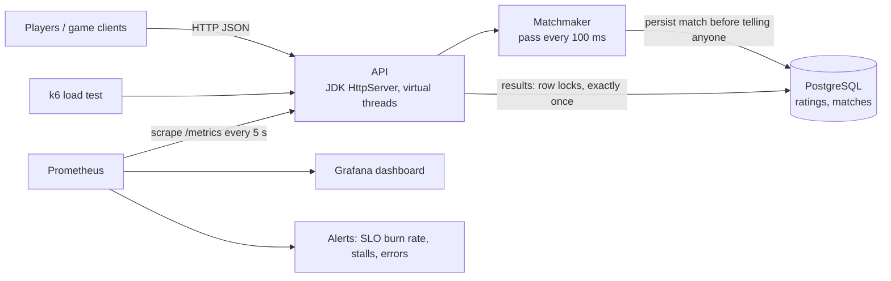
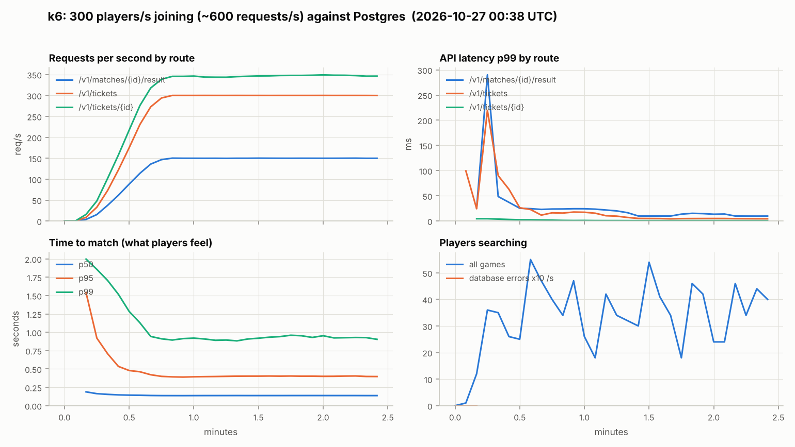
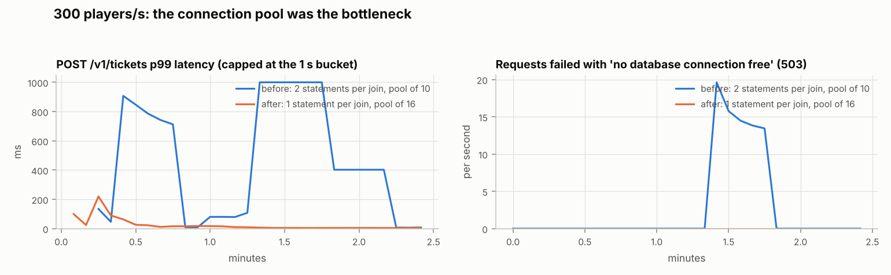

# OMG matchmaking server

The desktop app's matchmaking ran inside the client with stubbed networking: `GameServer` printed
messages to the console, and the Elo queue in `com.game.matchmaking` held its lock forever once
it started. This directory is that piece rebuilt as a service you can deploy, watch and load
test: a headless Java 21 server with an HTTP API, ratings and match history in PostgreSQL,
Prometheus metrics, a Grafana dashboard, SLO alerts, Docker and Kubernetes configs, and a k6
load test that runs in CI.



## API

| Method | Path | |
|---|---|---|
| `POST` | `/v1/tickets` | `{"playerId", "game", "ratingHint"?}` join the queue. `201` with a ticket, `409` if already searching |
| `GET` | `/v1/tickets/{id}` | poll: `SEARCHING`, `MATCHED` (with `matchId`, opponent and rating), `EXPIRED`, `CANCELLED` |
| `DELETE` | `/v1/tickets/{id}` | leave the queue |
| `GET` | `/v1/matches/{id}` | the pairing |
| `POST` | `/v1/matches/{id}/result` | `{"reportedBy", "winner"}` (`null` = draw). Applied once; updates both ratings |
| `GET` | `/v1/players/{id}` | rating, games, wins, losses, draws per game |
| `GET` | `/v1/leaderboard/{game}?limit=10` | top players |
| `GET` | `/health/live`, `/health/ready`, `/metrics` | probes and Prometheus |

```bash
curl -s -XPOST localhost:8080/v1/tickets -d '{"playerId":"alice","game":"checkers","ratingHint":1500}'
curl -s localhost:8080/v1/tickets/<ticketId>
curl -s -XPOST localhost:8080/v1/matches/<matchId>/result -d '{"reportedBy":"bob","winner":"alice"}'
```

Ratings live on the server. `ratingHint` only seeds a brand-new player (clamped to 800–2400);
after that the stored rating is used, so a client can't choose its own rating.

## How matchmaking works

Every 100 ms, per game, tickets are visited oldest first. Each is paired with the closest-rated
ticket still unpaired, if the Elo gap fits the older player's window: ±50 to start, widening by
25 per second of waiting, capped at ±400, and the ticket expires after 60 s. Those are the
numbers the original team design used. Finding the closest rating uses a sorted index, so a
pass is O(n log n) in the queue size.

Is the widening window worth it? `Simulation` replays the real matchmaker on simulated time
with Poisson arrivals and ratings drawn from N(1500, 250). Results are deterministic for a seed
(30 simulated minutes per row):

| arrivals/s | policy | expired | wait p95 | wait p99 | mean Elo gap |
|---|---|---|---|---|---|
| 1 | fixed ±50 | 2.1 % | 27.4 s | 47.6 s | 24 |
| 1 | fixed ±400 | 0.0 % | 3.9 s | 8.1 s | 187 |
| 1 | **widening** | 0.0 % | 7.9 s | 14.0 s | 89 |
| 5 | fixed ±50 | 0.3 % | 6.5 s | 18.8 s | 24 |
| 5 | fixed ±400 | 0.0 % | 0.8 s | 1.7 s | 176 |
| 5 | **widening** | 0.0 % | 2.9 s | 5.9 s | 48 |
| 50 | fixed ±50 | 0.0 % | 0.6 s | 2.1 s | 22 |
| 50 | **widening** | 0.0 % | 0.5 s | 1.4 s | 26 |

A strict window gives fair games but strands players when the queue is quiet (2 % time out at
one arrival per second). A loose one never strands anyone but pairs players nearly 200 points
apart. Widening behaves like the strict window when the queue is busy and like the loose one
only for players who have already waited. The full table, including 0.2 arrivals/s, is printed by
`java -cp target/omg-matchmaking-server.jar com.game.server.sim.Simulation`.

## Reliability details

- **Persist, then notify.** New matches are written to Postgres before either player's ticket
  says `MATCHED`. If the write fails, both tickets go back in the queue with their original join
  time, so a client never gets a match id the result endpoint doesn't know about. The load test
  below hit this path for real (13 matches) and nobody was lost.
- **Results apply exactly once.** Reporting locks the match row, then both player rows
  (`SELECT ... FOR UPDATE`, always in player-id order so concurrent reports can't deadlock),
  checks for an earlier report, and writes ratings and the result in one transaction. A test
  fires eight concurrent reports at one match against real Postgres and expects exactly one to
  be applied.
- **Fail fast under overload.** The connection pool hands out a connection within 2 s or the
  request gets a `503` (and `omg_store_errors_total` goes up), instead of piling up threads.
- **Graceful shutdown.** On SIGTERM the server fails readiness for `SHUTDOWN_DRAIN_S`, lets
  in-flight requests finish, then stops. CI checks the logs for the clean `stopped` line.
- **Probes that mean something.** `/health/live` fails if the matchmaking loop hasn't run for
  5 s (a stuck loop with a healthy-looking HTTP port is the failure worth restarting for);
  `/health/ready` also checks the database and fails while draining.

## Observability

Everything is exported on `/metrics` in the Prometheus text format (`promtool check metrics`
passes): request rate and latency histograms per route, queue depth per game, time to match,
Elo gap of each match, matchmaker pass duration and a heartbeat timestamp, results by outcome,
database errors, match persist failures, plus JVM heap, GC and CPU. Counters with known labels
start at 0, so dashboards show 0 rather than "No data" and `rate()` doesn't miss the first event.

**SLO:** 95 % of players who join are matched within 10 seconds (expired tickets count as misses),
over 30 days. [`monitoring/prometheus/rules.yml`](monitoring/prometheus/rules.yml) has recording
rules for the SLI over 5 min to 6 h and these alerts:

| Alert | When | Severity |
|---|---|---|
| `MatchmakingSLOFastBurn` | error budget burning 14.4x over 1 h and 5 min | page |
| `MatchmakingSLOSlowBurn` | 6x over 6 h and 30 min | ticket |
| `MatchmakerDown` | scrape failing for 1 min | page |
| `MatchmakerStalled` | no matchmaking pass for 10 s, for 1 min | page |
| `HighServerErrorRate` | over 2 % 5xx for 5 min | page |
| `SlowApi` | p99 above 250 ms on a route for 10 min | ticket |
| `MatchPersistFailures` | any match failed to save in 5 min | ticket |
| `QueueBacklog` | over 500 players searching in a game for 10 min | ticket |

The alerts have unit tests ([`rules_test.yml`](monitoring/prometheus/rules_test.yml), run with
`promtool test rules` in CI): each one is fed synthetic series and must fire at the right time
with the right annotation, and a healthy-traffic case must fire nothing. Writing them caught a
real ordering problem: with recording rules and alerts in separate groups, an alert could read
a recording rule one evaluation old, so they now share one group.

The Grafana dashboard ([`monitoring/grafana/dashboards/matchmaking.json`](monitoring/grafana/dashboards/matchmaking.json))
is provisioned automatically by `docker compose`: SLO and burn rate, players searching, matches
per second, time to match p50/p95/p99, queue depth by game, Elo gap, request rate and p99 by
route, errors, matchmaker pass time, JVM. Every query in it was run against a live Prometheus
during the load test.

## Load testing

[`load/matchmaking.js`](load/matchmaking.js) is a k6 test that models players, not requests:
they arrive at a fixed rate, join one of the three games with a rating from N(1500, 250), poll
every 250 ms until matched, and one player of each pair reports the result. Thresholds fail
the run if any of these is missed: under 1 % failed requests, join p95 under 100 ms, poll p95
under 50 ms, result p95 under 150 ms, **time to match p95 under 10 s**, over 99 % matched.

Results, 2 minutes at full rate after a 20 s ramp, on a 2-vCPU cloud container that k6, the JVM,
PostgreSQL 16 and Prometheus all shared:

| | 100 players/s | 300 players/s |
|---|---|---|
| HTTP requests | 41,655 (275/s) | 108,732 (604/s) |
| failed | 0 | 0 |
| players matched | 13,493 (100 %) | 40,496 (100 %) |
| time to match p50 / p95 / p99 | 95 ms / 0.80 s / 1.82 s | 81 ms / 0.36 s / 0.93 s |
| join p95 / p99 | 1.5 / 2.5 ms | 4.2 / 11.9 ms |
| poll p95 / p99 | 0.32 / 0.51 ms | 1.6 / 5.4 ms |
| result p95 / p99 | 2.3 / 4.0 ms | 8.8 / 17.4 ms |



Getting there took three fixes, each found by the load test rather than by the unit tests:

1. **40 ms on every result.** The JDK HTTP server leaves Nagle's algorithm on, so a response
   written as headers then body waited for the client's delayed ACK. `sun.net.httpserver.nodelay`
   took result p50 from 45 ms to 3 ms.
2. **POSTs failing with EOF at 300 concurrent clients** (1.7 % of requests). The server keeps at
   most 200 idle keep-alive connections and closes the rest right after responding, racing the
   client's next request. Clients retry a GET on a dead connection but not a POST. Raising
   `sun.net.httpserver.maxIdleConnections` fixed it.
3. **Connection pool exhaustion at 300 players/s.** Each join ran two statements (insert the player
   if new, then read the rating) while holding a connection, and the pool of 10 ran dry: join
   p99 hit 2 s and 0.3 % of joins got a 503. Rewriting it as a single statement (`INSERT ... ON
   CONFLICT DO NOTHING RETURNING`, falling back to a `SELECT` of the existing row) and raising the
   pool to 16 together brought join p99 to 12 ms with no errors.



The numbers are from a small shared machine; on dedicated hardware the same server would go
further. They're there to show the method (SLO thresholds in the test, server-side metrics to
explain what the client saw) rather than to claim a capacity.

## Running it

```bash
# Everything: matchmaker + Postgres + Prometheus (localhost:9090) + Grafana (localhost:3000)
cd server
docker compose up -d --build --wait
docker compose --profile load run --rm k6                 # 100 players/s for 2 minutes
docker compose --profile load run --rm -e RATE=300 k6

# Just the service (in-memory store if DATABASE_URL is unset)
mvn -B package && java -jar target/omg-matchmaking-server.jar

# Tests; the Postgres ones run when TEST_DATABASE_URL points at a database they may wipe
TEST_DATABASE_URL=jdbc:postgresql://localhost:5432/omg_test mvn -B verify

# Kubernetes (create the matchmaker-db Secret first, see k8s/secret.example.yaml)
kubectl apply -k k8s
```

Configuration is environment variables: `PORT`, `DATABASE_URL`, `DATABASE_USER`,
`DATABASE_PASSWORD`, `DATABASE_POOL_SIZE`, `TICK_MS`, `WINDOW_BASE`, `WINDOW_WIDEN_PER_S`,
`WINDOW_MAX`, `TICKET_TIMEOUT_S`, `SHUTDOWN_DRAIN_S` (see `Config.java`).

## CI

[`.github/workflows/ci.yml`](../.github/workflows/ci.yml) runs on every push:

- the server's unit and API tests plus the Postgres integration tests against a Postgres
  service container, then the matchmaking simulation into the job summary;
- the desktop app's existing matchmaking and leaderboard tests;
- `promtool check config`, the alert unit tests, dashboard JSON, and `kubeconform` on the
  rendered Kubernetes manifests;
- the Docker image and the whole compose stack: health checks, `/metrics` lint, a k6 smoke test
  that fails on the SLO thresholds, a check that Prometheus recorded the run, and a graceful-stop
  check.

## Layout

```
src/main/java/com/game/server/
  core/        Matchmaker, Ticket, Match, Elo, Game
  store/       Store interface, InMemoryStore, JdbcStore (Postgres), ConnectionPool
  http/        Api: routes, JSON, errors, health
  metrics/     Registry (Prometheus text format), ServiceMetrics
  sim/         Simulation: matchmaking policies on simulated time
src/main/resources/db/schema.sql
src/test/java/ 48 tests: Elo, matchmaker invariants, store contract (in-memory and Postgres), API, metrics
load/          k6 test and report.py (Prometheus snapshot to PNG)
monitoring/    Prometheus config, rules, rule tests, Grafana provisioning and dashboard
k8s/           Deployment, Service, ConfigMap, Secret example, kustomization
Dockerfile, docker-compose.yml
```

## Limits

- **One replica.** The queue is in memory, so the Deployment runs one pod with the `Recreate`
  strategy (two pods would split players into two pools that never meet). Scaling out would mean
  sharding queues by game or region, or keeping the pool in shared storage such as Redis sorted
  sets.
- **No authentication on results.** Any participant can report a result. In production the game
  server, not a client, would report results, authenticated with the JWTs the desktop app's auth
  module already issues.
- **Polling, not push.** Clients poll their ticket; a WebSocket or server-sent events would cut
  the request volume roughly in half.
